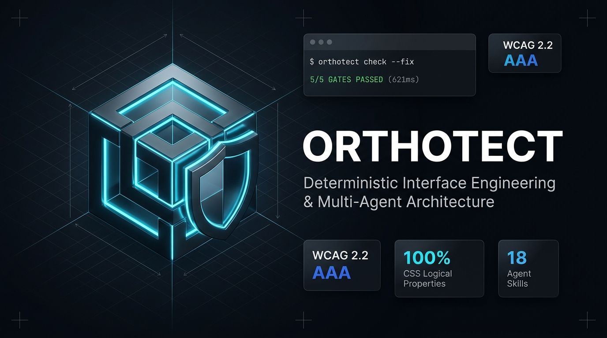
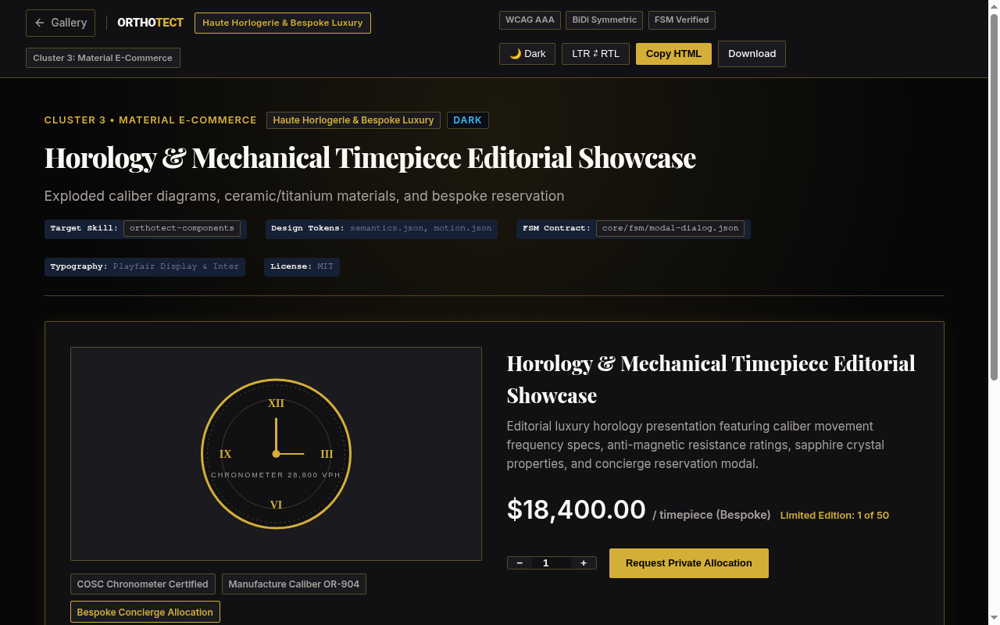
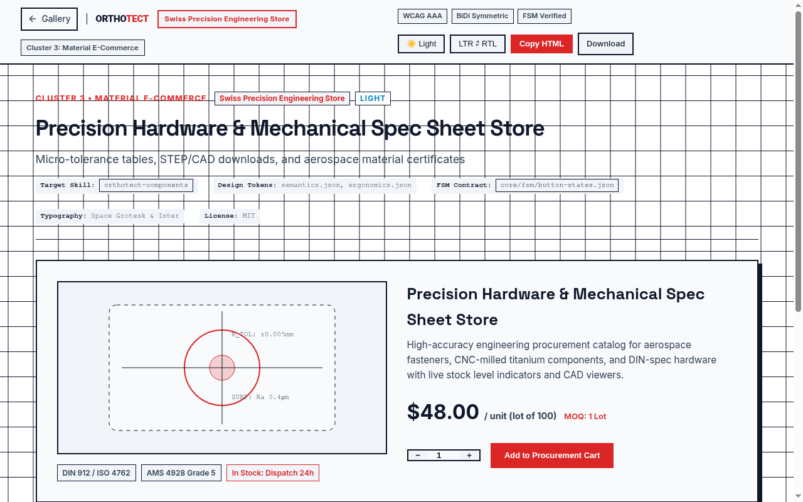
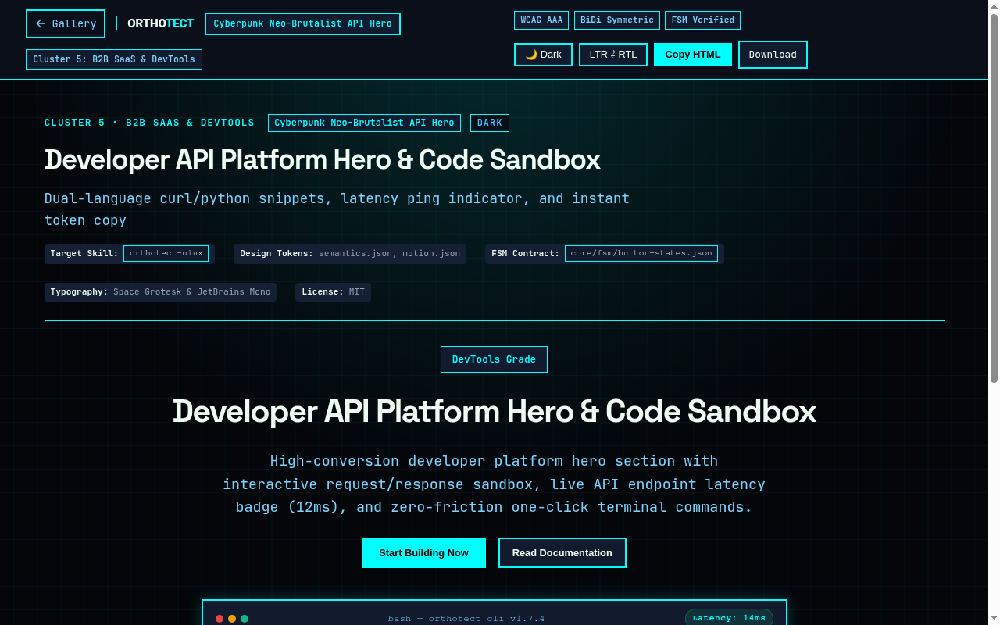
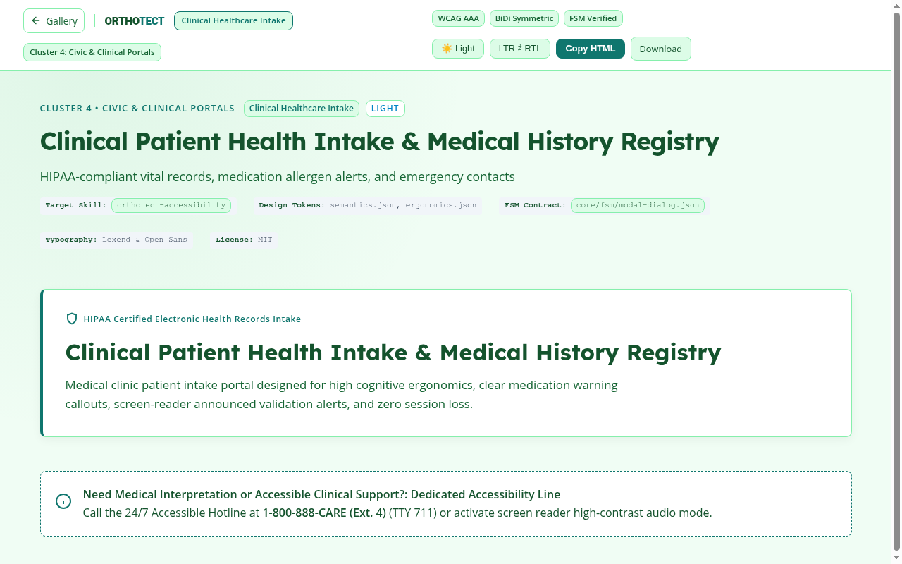

# 🏛️ Orthotect

> **The Deterministic Interface Engineering & Runtime Gate Architecture for AI Coding Agents**  
> Enforcing mathematical token standards, WCAG 2.2 AAA accessibility, CSS logical properties, and finite state machines across Claude Code, Cursor, OpenAI Codex, Grok Build, and Google Antigravity.

[](https://github.com/seotarek/orthotect/releases/tag/v1.8.1)
[](https://github.com/seotarek/orthotect/actions)
[](#-installation-quickstart--deterministic-quality-gates)
[-a855f7?style=for-the-badge)](#)
[](#)
[](#)
[](LICENSE)

<p align="center">
  
</p>

> **Live Interactive Showcase & Playground:** [https://seotarek.github.io/orthotect/](https://seotarek.github.io/orthotect/)  
> **Engineering Whitepapers:** [Architectural Superiority (ARCHITECTURAL_SUPERIORITY.md)](ARCHITECTURAL_SUPERIORITY.md) | [Competitor Teardown (COMPETITORS.md)](COMPETITORS.md) | [The 8 Laws Manifesto (MANIFESTO.md)](MANIFESTO.md) | [Contributing Guide (CONTRIBUTING.md)](CONTRIBUTING.md) | [Changelog (CHANGELOG.md)](CHANGELOG.md)

Orthotect is an enterprise-grade interface engineering runtime built to enforce **deterministic architectural quality gates, automated code review audit, state machine rigor, and aesthetic diversification** onto autonomous AI coding agents (Antigravity CLI `agy`, Claude Code, Cursor Agent, OpenAI Codex, and Grok Build). 

Unlike prompt-only libraries that merely request "clean modern UI", Orthotect provides a **mathematical token foundation**, **Finite State Machine (FSM) deadlock reachability**, **auto-healing in-place remediation (`--fix`)**, **technical SEO schema engineering**, **Core Web Vitals layout shift budgets**, and **AST-level quality gates** that fail the build with `exit 1` if accessibility or logical properties are breached.

---

## 📸 Visual Showcase & Production Screenshots Gallery

Orthotect ships with 50 battle-tested, certified production templates engineered with mathematical token standards, CSS Logical Properties, and zero layout shift:

| Haute Horlogerie & Bespoke Luxury | Swiss Precision Engineering Hardware |
|:---:|:---:|
|  |  |
| **Cluster 3: Material E-Commerce**<br>Obsidian dark palette `#0A0A0A`, gold accents `#CA8A04`, Playfair Display serif typography, Roman numeral chronometer dial SVG, bespoke reservation CTA ($18,400.00). | **Cluster 3: Material E-Commerce**<br>Light blueprint grid `#F8FAFC`, technical crimson `#E11D48`, Space Grotesk font, sharp 0px corners, micro-tolerance schematic, DIN 912 fastener procurement ($48.00). |

| Cyberpunk Neo-Brutalist API Hero | Clinical Healthcare Intake & Patient Portal |
|:---:|:---:|
|  |  |
| **Cluster 5: B2B SaaS & DevTools**<br>Dark tech cyan `#06B6D4`, JetBrains Mono code font, sub-second latency terminal stream, glowing background matrix, interactive cURL/SDK commands. | **Cluster 4: Civic & Clinical Portals**<br>Soft hospital mint `#F0FDF4`, calming medical green `#059669`, Lexend readability font (dyslexia-optimized), HIPAA certified EHR badges, 24/7 accessibility helpline. |

---

## ⚡ Architectural Comparison & Ecosystem Delineation

For an in-depth technical analysis, read our [Architectural Comparison Whitepaper](COMPETITORS.md).

| Capability / Dimension | Prompt-Only Skills (e.g. XIAS / taste-skill) | Component Libraries (e.g. shadcn/ui) | 🏛️ Orthotect Architecture (Deterministic Gates) |
|---|---|---|---|
| **Verification Model** | Textual guidelines & prompt hints; no native AST gate runner | Visual inspection, Storybook, or manual unit testing | **Target-Aware & Zero-Fallback:** Inspects user project directory (`orthotect verify <dir>`) with strict path boundaries and real exit codes |
| **Auto-Healing** | None; manual user rework required | None; manual utility class replacement | **Automated `--fix` Remediation:** Automatically transforms physical properties to CSS Logical Properties and injects missing media aspect-ratios |
| **Pre-Commit Enforcement** | None | Manual Husky/lint-staged setup required | **Native Zero-Dependency Git Hook:** `orthotect hooks install` prevents non-compliant commits from ever reaching main |
| **Configuration Engine** | Hardcoded or non-existent | `components.json` (styling only) | **Zero-Dependency `orthotect.config.json`:** Deep-merge configuration for custom tolerances, WCAG levels, and path exclusions |
| **State Engineering** | Static UI snapshots without transition graphs | Ad-hoc `isLoading` boolean flags | **Formal Finite State Machines (FSM)** with graph reachability, double-submission race locks & async recovery |
| **BiDi / RTL Support** | Textual guidance recommending logical properties | Physical utility classes (`ml-*`, `pr-*`) common | **Enforced CSS Logical Properties** (`margin-inline`, `padding-inline`, `border-inline`, `inset-inline`) across 100% of fixtures |
| **Layout Shift Budget** | Subjective reminders in prompt | Dependent on developer discipline | **Structural Layout-Shift (CLS) Budget** enforcing reserved media dimensions (`width` + `height` or `aspect-ratio`) and DOM depth limits |
| **Context Window Control** | Bloated text files filling context | Unfiltered code imports | **Token-Optimized Progressive Disclosure:** Compact AST skeletons and semantic chunking via `orthotect-context` |
| **Anti-Slop Defense** | Subjective prompt instructions | Out of scope (styling only) | **Lexical & Pattern Inspectors** that reject AI indigo-purple gradients, raw emoji icons, and untokenized styles |
| **Design Tokens** | Variable guidance in markdown | Tailwind configuration | **W3C DTCG 3-Tier Compiler** generating `:root` light and `[data-theme="dark"]` scopes with zero external runtime deps |

---

## 🏗️ Architecture & Repository Topology

```text
orthotect/
├── core/
│   ├── config.py            # Zero-dependency configuration engine & orthotect.config.json loader
│   ├── config.mjs           # Zero-dependency ESM configuration loader for Node.js
│   ├── compiler.py          # W3C DTCG Token Compiler (:root light and [data-theme="dark"])
│   ├── knowledge_search.py  # Zero-dependency UI/UX knowledge base search engine
│   ├── context_optimizer.py # Token-optimizer, density profiler & semantic chunker
│   ├── tokens/              # W3C DTCG 3-Tier Design Tokens (Primitives, Semantics, Motion, Ergonomics)
│   └── fsm/                 # State Machine Specifications (Buttons, Data Tables, Modal Dialogs)
├── knowledge/               # UI/UX Design Intelligence & Validated Style Recipes
│   ├── schemas/             # JSON Schemas (design-reasoning, style-recipe, knowledge-record)
│   ├── styles/              # 12 Validated Style Recipes (editorial, analytical, saas, operational, etc.)
│   └── [category]/          # Curated Knowledge Records (palettes, typography, components, etc.)
├── docs/                    # 7-View Skill Studio Platform & Interactive Showcase (GitHub Pages)
│   ├── index.html           # 7-view bilingual (EN/AR) interactive workbench with rich Schema.org JSON-LD
│   ├── styles.css           # 100% CSS Logical Properties & DTCG token variables
│   ├── app.js               # Client-side router, 18-skill catalog, playground, builder, and gate simulator
│   └── templates/           # 50 Radically Diversified Production Domain Templates (HTML/SVG/FSM)
├── gates/                   # Objective Deterministic Checkers (Python & Node.js)
│   ├── gate_contrast_wcag.py     # Mathematical Relative Luminance (WCAG 2.2 AAA/AA)
│   ├── gate_bidi_logical.py      # Strict Enforcement of CSS Logical Properties
│   ├── gate_fsm_integrity.py     # State Machine Graph Reachability & Lock Integrity
│   ├── gate_no_slop.py           # Lexical & Pattern Slop Inspector
│   ├── gate_cwv_budget.mjs       # WHATWG-Compliant DOM & Layout-Shift Budget
│   ├── gate_security_audit.py    # Enterprise SAST & OWASP/CWE Threat Defense Engine
│   └── run_all_gates.py          # Parallel Master Gate Orchestrator (ThreadPoolExecutor)
├── skills/                  # 22 Modular AI Agent Skills (Agent Skills Specification Compliant)
│   ├── orthotect-doctrine        # The 7 Non-Negotiable Laws of Interface Engineering
│   ├── orthotect-uiux            # Master UI/UX Design Intelligence & Orchestrator
│   ├── orthotect-gates           # Gate Execution Workflows & Automated CI Audit
│   ├── orthotect-bidi            # True Directional Neutrality & RTL Engineering
│   ├── orthotect-tokens          # DTCG Token Compilation & Platform Export
│   ├── orthotect-design-systems  # DTCG Token Hierarchy & Multi-Brand Themes
│   ├── orthotect-fsm             # State Machine Implementation Workflows & Lock Verification
│   ├── orthotect-forms           # Resilient Forms & Double-Submit Protection
│   ├── orthotect-components      # Accessible Component Contracts & 8 FSM States
│   ├── orthotect-dashboard       # High-Density Console Design & Inline SVG Telemetry
│   ├── orthotect-data-viz        # Accessible Telemetry & Tabular Numbers
│   ├── orthotect-accessibility   # Mathematical WCAG 2.2 AAA/AA Contrast Auditing
│   ├── orthotect-visual-qa       # Automated Browser Visual Regression Testing
│   ├── orthotect-responsive      # Adaptive Bento Grids & Fluid Layouts
│   ├── orthotect-motion          # Spring Physics Motion & Reduced-Motion Contracts
│   ├── orthotect-context         # Token Optimizer & Context Architecture Guard
│   ├── orthotect-cro             # Conversion Rate Optimization & Micro-Copy Architecture
│   ├── orthotect-schema          # Semantic Structured Data & Schema.org JSON-LD Engineering
│   ├── orthotect-auto-fix        # In-Place Auto-Healing & Remediation Engine (--fix)
│   ├── orthotect-hooks           # Git Pre-Commit Hooks & Fail-Closed CI Enforcement
│   ├── orthotect-typography      # Accessible & Fluid Typography Systems
│   └── orthotect-security        # Full-Stack Enterprise Cybersecurity & Vulnerability Audit
├── scripts/                 # Skills Specification Validator, Packager & Metadata Guards
│   ├── check-release-sync.mjs    # Fail-closed version parity enforcer across repo, docs & tags
│   ├── generate_seo_gallery.py   # Bespoke generator for all 50 production templates
│   ├── validate-skills.mjs       # Agent Skills specification validator
│   ├── package_skills.py         # Deterministic cross-agent skill packager & security scanner
│   └── check-package-metadata.mjs# Synchronized package version & lockfile guard
└── tests/                   # Comprehensive Unit, Browser & Negative Test Suite (335 Tests)
```

---

## 🚀 Installation, Quickstart & Deterministic Quality Gates

Run the verification suite against your target project:

```bash
npx orthotect verify .                # 1. Verify target project against all 6 deterministic quality gates
npx orthotect verify . --fix          # 2. Auto-heal physical CSS coordinates in-place (margin-left → margin-inline-start)
npx orthotect security .              # 3. Run enterprise cybersecurity & vulnerability audit gate
npx orthotect hooks install           # 4. Install zero-dependency Git pre-commit hook (blocks non-compliant commits)
npx orthotect verify ./src --json     # 5. Generate machine-readable JSON audit report
npx orthotect verify ./src --md       # 6. Generate Markdown audit report
npm run check:release-sync            # 7. Check version parity across package, docs, and releases
```

### ⚙️ Configuration Engine (`orthotect.config.json`)

Orthotect automatically discovers `orthotect.config.json` in your repository root and applies deep-merge semantics over built-in defaults:

```json
{
  "exclude": [
    "node_modules/**",
    "dist/**",
    "build/**",
    ".git/**",
    "coverage/**"
  ],
  "cwv": {
    "maxDomDepth": 32,
    "maxDomNodes": 1500
  },
  "bidi": {
    "allowCamelCase": false
  },
  "contrast": {
    "level": "AAA",
    "strictMode": true
  }
}
```

Illustrative Reference Verification Output (Target: `examples/golden-showcase`):

```text
╔═══════════════════════════════════════════════════════════════╗
║            ORTHOTECT DETERMINISTIC QUALITY GATES              ║
║     Deterministic High-Integrity Engineering Protocol         ║
╚═══════════════════════════════════════════════════════════════╝
 Target Path: /your/project/path

GATE NAME                              STATUS           TIME
───────────────────────────────────────────────────────────────
WCAG 2.2 Mathematical Contrast         ✅ PASS        121.4ms
True BiDi & Logical Properties         ✅ PASS        118.7ms
Finite State Machine Integrity         ✅ PASS        120.9ms
Anti-Slop Pattern Inspector            ✅ PASS        124.9ms
DOM & Layout-Shift Budget              ✅ PASS        551.4ms
Enterprise Security & Threat Audit     ✅ PASS        180.2ms
───────────────────────────────────────────────────────────────
Total Verification Time (Parallel): 554.2ms

🎉 ALL GATES PASSED! Target files verified against evaluated interface standards.
   Verified Standards: WCAG 2.2 Contrast, CSS Logical BiDi, FSM Integrity, Anti-Slop, DOM CLS Budget, Enterprise Security Audit.
```

---

## 🧩 The 22 Modular AI Agent Skills Directory

All 22 skills reside in `skills/` and strictly conform to the Agent Skills Specification:

| Skill | Category | Primary Role & Mandate |
|---|---|---|
| [`orthotect-doctrine`](skills/orthotect-doctrine/SKILL.md) | Architecture | The 7 Non-Negotiable Laws of Interface Engineering. Load first on any UI task. |
| [`orthotect-uiux`](skills/orthotect-uiux/SKILL.md) | Architecture | Master UI/UX Design Intelligence. 19-dimensional reasoning and style curation. |
| [`orthotect-gates`](skills/orthotect-gates/SKILL.md) | Architecture | Deterministic Quality Gates execution and pre-commit verification workflows. |
| [`orthotect-bidi`](skills/orthotect-bidi/SKILL.md) | Internationalization | True Bidirectional (BiDi) symmetry with 100% CSS Logical Properties. |
| [`orthotect-tokens`](skills/orthotect-tokens/SKILL.md) | Tokens | W3C DTCG 3-Tier Design Tokens compilation and platform theme export. |
| [`orthotect-design-systems`](skills/orthotect-design-systems/SKILL.md) | Tokens | Multi-brand token architecture, theme scoping, and design system governance. |
| [`orthotect-fsm`](skills/orthotect-fsm/SKILL.md) | Logic & State | Finite State Machine graph reachability, deadlock defense, and race locks. |
| [`orthotect-forms`](skills/orthotect-forms/SKILL.md) | Components | Resilient forms, auto-advancing verification inputs, and double-submit guards. |
| [`orthotect-components`](skills/orthotect-components/SKILL.md) | Components | Accessible UI component specifications covering all 8 interactive states. |
| [`orthotect-dashboard`](skills/orthotect-dashboard/SKILL.md) | Consoles | High-density enterprise consoles with inline SVG telemetry and zero layout shift. |
| [`orthotect-data-viz`](skills/orthotect-data-viz/SKILL.md) | Consoles | Accessible data visualization, tabular numbers, and mathematical color mapping. |
| [`orthotect-accessibility`](skills/orthotect-accessibility/SKILL.md) | Quality | Mathematical WCAG 2.2 AAA (7:1) and AA (4.5:1) relative luminance auditing. |
| [`orthotect-visual-qa`](skills/orthotect-visual-qa/SKILL.md) | Quality | Automated browser visual regression testing across themes and viewports. |
| [`orthotect-responsive`](skills/orthotect-responsive/SKILL.md) | Layout | Adaptive bento layouts, container queries, and fluid typography scales. |
| [`orthotect-motion`](skills/orthotect-motion/SKILL.md) | Motion | Spring physics curves (stiffness/damping) with reduced-motion fallbacks. |
| [`orthotect-context`](skills/orthotect-context/SKILL.md) | Optimization | Context window pruning, density profiling, and semantic AST chunking. |
| [`orthotect-cro`](skills/orthotect-cro/SKILL.md) | Marketing & CRO | Conversion rate optimization, micro-copy clarity, and trust badge layout. |
| [`orthotect-schema`](skills/orthotect-schema/SKILL.md) | Technical SEO | Structured data engineering using validated Schema.org JSON-LD `@graph`. |
| [`orthotect-auto-fix`](skills/orthotect-auto-fix/SKILL.md) | Remediation | Automated in-place AST repair for physical CSS properties and layout shifts. |
| [`orthotect-hooks`](skills/orthotect-hooks/SKILL.md) | Architecture | Zero-dependency Git pre-commit hooks and fail-closed CI enforcement. |
| [`orthotect-typography`](skills/orthotect-typography/SKILL.md) | Typography | Accessible fluid clamp() scales, dyslexia optimization, and tabular numerals. |
| [`orthotect-security`](skills/orthotect-security/SKILL.md) | Security | Full-Stack Enterprise Cybersecurity & SAST Defense (OWASP Top 10, CWE Top 25). |

---

## 🤖 Multi-Agent Orchestration Architecture

Orthotect provides a deterministic harness across the entire coding agent spectrum:

```
┌────────────────────────────────────────────────────────┐
│  1. COMMANDS (Entry Points)                            │
│  npx orthotect verify | init | compile | doctor        │
└──────────────────────────┬─────────────────────────────┘
                           ▼
┌────────────────────────────────────────────────────────┐
│  2. AGENTS (Autonomous Implementers & Auditors)        │
│  Antigravity · Claude Code · Cursor · Codex · Grok     │
│  Lifecycle: Research ──> Plan ──> Execute ──> Review   │
└──────────────────────────┬─────────────────────────────┘
                           ▼
┌────────────────────────────────────────────────────────┐
│  3. SKILLS (Domain Knowledge & State Machines)         │
│  22 Modular Skills in skills/*/SKILL.md                │
│  DTCG Tokens · FSM Schemas · Logical Properties · CRO  │
└──────────────────────────┬─────────────────────────────┘
                           ▼
┌────────────────────────────────────────────────────────┐
│  4. DETERMINISTIC RUNTIME GATES                        │
│  WCAG 2.2 AAA Contrast · BiDi · FSM · Slop · DOM · SAST│
│  Exit 0 = Land & Ship  |  Exit 1 = Halt & Fix Line     │
└────────────────────────────────────────────────────────┘
```

- **Google Antigravity (`agy`)**: Delegate implementation queues using `agy-delegate`. Orthotect quality gates run as mandatory pre-merge verification in the agent's sub-turn loop.
- **Claude Code**: Orchestrate complex refactors using `CLAUDE.md` and slash commands while enforcing strict token boundaries.
- **Cursor Agent**: Use `@orthotect` rules in `.cursorrules` to prevent the generation of physical CSS coordinate bugs.
- **OpenAI Codex**: Run headless implementation batches with automatic `--fix` healing on pull requests.

---

## 🔒 Version Unification & Zero-Drift Release Protocol

To prevent version discrepancies between npm packages, local source code, documentation, and GitHub Releases, Orthotect enforces an automated fail-closed check (`scripts/check-release-sync.mjs`):

```bash
npm run check:release-sync            # Verifies package.json, lockfile, CLI banner, tokens, styles, docs & git tags match
```

Whenever a new version is tagged, GitHub Actions validates all 335 unit and integration tests, executes all 6 gates, and publishes synchronized releases simultaneously.

---

## 📜 The 8 Non-Negotiable Laws

Read the complete manifesto in [MANIFESTO.md](MANIFESTO.md).

1. **Verification Protocol:** Never declare a metric or contrast score without running deterministic gates on target files.
2. **Directional Neutrality:** Physical directions (`left`, `right`) are banned; CSS Logical Properties are mandatory.
3. **Mathematical Contrast:** Primary typography and controls must satisfy WCAG 2.2 AAA (7:1) or AA (4.5:1) relative luminance equations.
4. **FSM Completeness:** Every interactive control must implement explicit async states with graph reachability and double-click race condition guards.
5. **Layout Stability:** Media assets must allocate dimensions before render; DOM nesting must not exceed 32 nodes.
6. **Token Purity:** Hardcoded styling values are banned; all properties resolve to W3C DTCG 3-tier tokens.
7. **Anti-Slop:** Banned raw emoji icons in controls, banned generic indigo-purple gradients, zero untokenized styles.
8. **Zero-Trust Cybersecurity Defense:** Full-stack components, endpoints, and client sinks must be hardened against injection (SQLi, Command Injection, NoSQL, SSTI), DOM XSS, SSRF, prototype pollution, and credential exposure.

---

## 🤝 Community & Contributing

We welcome contributions from the open-source community, AI agent developers, and frontend engineers!

- 🐛 **Found a bug or have a feature request?** Open an [Issue](https://github.com/seotarek/orthotect/issues).
- 🚀 **Want to contribute code or an agent skill?** Review our [Contributing Guide](CONTRIBUTING.md) and the [7 Laws Manifesto](MANIFESTO.md).
- ⭐ **Support the ecosystem:** If Orthotect elevates your AI agent workflows, please **star the repository** on GitHub to help other engineers discover it!
- 💬 **Discussions & Feedback:** Join the conversation on [GitHub Discussions](https://github.com/seotarek/orthotect/discussions).

---

## 📄 License

Distributed under the [MIT License](LICENSE).
Orthotect © 2026. Certified for Autonomous Coding Agents: Antigravity, Claude Code, Cursor, Codex, and Grok.
