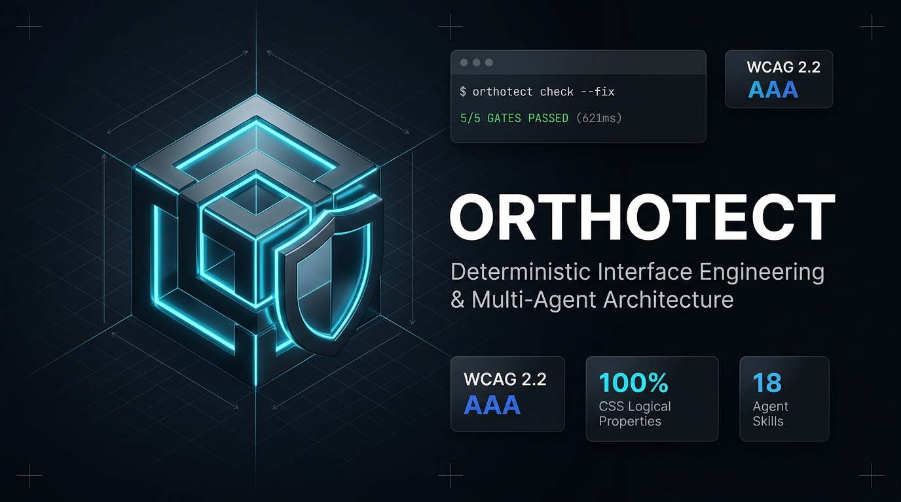
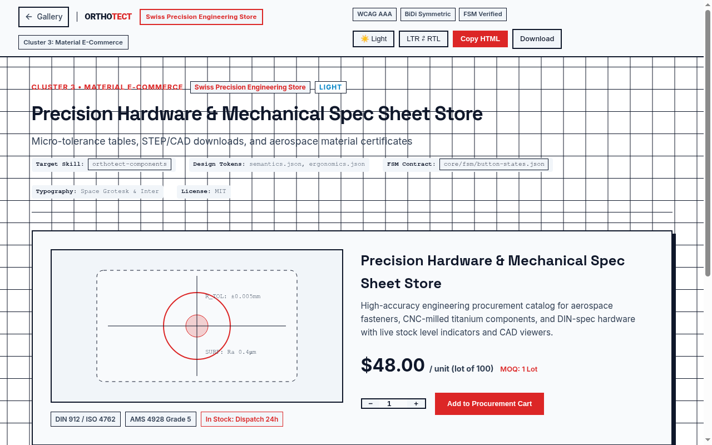
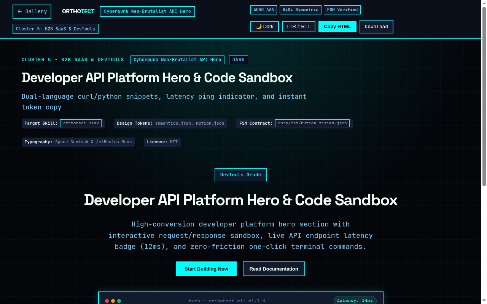
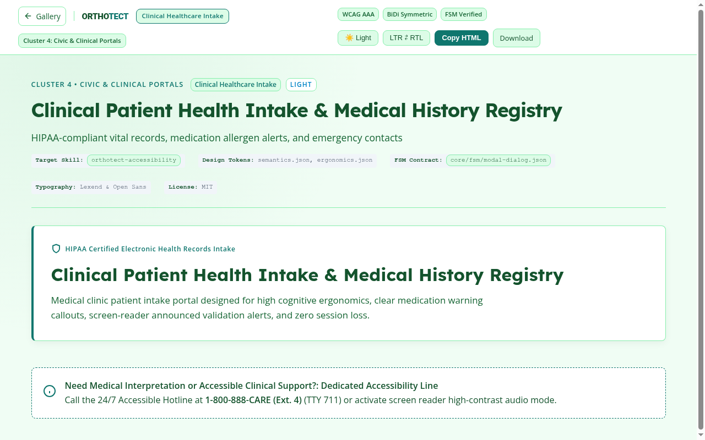

# 🏛️ Orthotect

> **The Deterministic Interface Engineering & Runtime Gate Architecture for AI Coding Agents**  
> Enforcing mathematical token standards, WCAG 2.2 AAA accessibility, CSS logical properties, and finite state machines across Claude Code, Cursor, OpenAI Codex, Grok Build, and Google Antigravity.

[](https://github.com/seotarek/orthotect/releases/tag/v1.8.8)
[](https://github.com/seotarek/orthotect/actions)
[](#-installation-quickstart--deterministic-quality-gates)
[-a855f7?style=for-the-badge)](#)
[](#)
[](#)
[](https://github.com/seotarek/orthotect/stargazers)
[](LICENSE)

<p align="center">
  
</p>

> **Live Interactive Showcase & Playground:** [https://seotarek.github.io/orthotect/](https://seotarek.github.io/orthotect/)  
> **Engineering Whitepapers:** [Architectural Superiority (ARCHITECTURAL_SUPERIORITY.md)](ARCHITECTURAL_SUPERIORITY.md) | [Competitor Teardown (COMPETITORS.md)](COMPETITORS.md) | [The 8 Laws Manifesto (MANIFESTO.md)](MANIFESTO.md) | [Contributing Guide (CONTRIBUTING.md)](CONTRIBUTING.md) | [Changelog (CHANGELOG.md)](CHANGELOG.md)

Orthotect is an enterprise-grade interface engineering runtime built to enforce **deterministic architectural quality gates, automated code review audit, state machine rigor, and aesthetic diversification** onto autonomous AI coding agents (Antigravity CLI `agy`, Claude Code, Cursor Agent, OpenAI Codex, and Grok Build). 

Unlike prompt-only libraries that merely request "clean modern UI", Orthotect provides a **mathematical token foundation**, **Finite State Machine (FSM) deadlock reachability**, **auto-healing in-place remediation (`--fix`)**, **technical SEO schema engineering**, **Core Web Vitals layout shift budgets**, and **AST-level quality gates** that fail the build with `exit 1` if accessibility or logical properties are breached, and `exit 2` when the verifier itself cannot run.

---

## 📸 Visual Showcase & Production Screenshots Gallery

Orthotect ships with 50 battle-tested, certified production templates engineered with mathematical token standards, CSS Logical Properties, and zero layout shift:

| Haute Horlogerie & Bespoke Luxury | Swiss Precision Engineering Hardware |
|:---:|:---:|
|  |  |
| **Cluster 3: Material E-Commerce**<br>Obsidian dark palette `#0A0A0A`, gold accents `#CA8A04`, Playfair Display serif typography, Roman numeral chronometer dial SVG, bespoke reservation CTA ($18,400.00). | **Cluster 3: Material E-Commerce**<br>Light blueprint grid `#F8FAFC`, technical crimson `#E11D48`, Space Grotesk font, sharp 0px corners, micro-tolerance schematic, DIN 912 fastener procurement ($48.00). |

| Cyberpunk Neo-Brutalist API Hero | Clinical Healthcare Intake & Patient Portal |
|:---:|:---:|
|  |  |
| **Cluster 5: B2B SaaS & DevTools**<br>Dark tech cyan `#06B6D4`, JetBrains Mono code font, sub-second latency terminal stream, glowing background matrix, interactive cURL/SDK commands. | **Cluster 4: Civic & Clinical Portals**<br>Soft hospital mint `#F0FDF4`, calming medical green `#059669`, Lexend readability font (dyslexia-optimized), HIPAA certified EHR badges, 24/7 accessibility helpline. |

---

## ⚡ Architectural Comparison & Ecosystem Delineation

For an in-depth technical analysis, read our [Architectural Comparison Whitepaper](COMPETITORS.md).

| Capability / Dimension | Prompt-Only Skills (e.g. XIAS / taste-skill) | Component Libraries (e.g. shadcn/ui) | 🏛️ Orthotect Architecture (Deterministic Gates) |
|---|---|---|---|
| **Verification Model** | Textual guidelines & prompt hints; no native AST gate runner | Visual inspection, Storybook, or manual unit testing | **Target-Aware & Zero-Fallback:** Inspects user project directory (`orthotect verify <dir>`) with strict path boundaries and real exit codes |
| **Auto-Healing** | None; manual user rework required | None; manual utility class replacement | **Automated `--fix` Remediation:** Automatically transforms physical properties to CSS Logical Properties and injects missing media aspect-ratios |
| **Pre-Commit Enforcement** | None | Manual Husky/lint-staged setup required | **Native Zero-Dependency Git Hook:** `orthotect hooks install` prevents non-compliant commits from ever reaching main |
| **Configuration Engine** | Hardcoded or non-existent | `components.json` (styling only) | **Zero-Dependency `orthotect.config.json`:** Deep-merge configuration for custom tolerances, WCAG levels, and path exclusions |
| **State Engineering** | Static UI snapshots without transition graphs | Ad-hoc `isLoading` boolean flags | **Formal Finite State Machines (FSM)** with graph reachability, double-submission race locks & async recovery |
| **BiDi / RTL Support** | Textual guidance recommending logical properties | Physical utility classes (`ml-*`, `pr-*`) common | **Enforced CSS Logical Properties** (`margin-inline`, `padding-inline`, `border-inline`, `inset-inline`) across 100% of fixtures |
| **Layout Shift Budget** | Subjective reminders in prompt | Dependent on developer discipline | **Structural Layout-Shift (CLS) Budget** enforcing reserved media dimensions (`width` + `height` or `aspect-ratio`) and DOM depth limits |
| **Context Window Control** | Bloated text files filling context | Unfiltered code imports | **Token-Optimized Progressive Disclosure:** Compact AST skeletons and semantic chunking via `orthotect-context` |
| **Anti-Slop Defense** | Subjective prompt instructions | Out of scope (styling only) | **Lexical & Pattern Inspectors** that reject AI indigo-purple gradients, raw emoji icons, and untokenized styles |
| **Design Tokens** | Variable guidance in markdown | Tailwind configuration | **W3C DTCG 3-Tier Compiler** generating `:root` light and `[data-theme="dark"]` scopes with zero external runtime deps |

---

## 🏗️ Architecture & Repository Topology

```text
orthotect/
├── core/
│   ├── config.py            # Zero-dependency configuration engine & orthotect.config.json loader
│   ├── config.mjs           # Zero-dependency ESM configuration loader for Node.js
│   ├── compiler.py          # W3C DTCG Token Compiler (:root light and [data-theme="dark"])
│   ├── knowledge_search.py  # Zero-dependency UI/UX knowledge base search engine
│   ├── context_optimizer.py # Token-optimizer, density profiler & semantic chunker
│   ├── security_baseline.py # Committed, reviewable SAST allowlist (file + rule + line + justification)
│   ├── exit_codes.py        # Exit-code contract (0 = pass, 1 = violation, 2 = tool error)
│   ├── tokens/              # W3C DTCG 3-Tier Design Tokens (Primitives, Semantics, Motion, Ergonomics)
│   └── fsm/                 # State Machine Specifications (Buttons, Data Tables, Modal Dialogs)
├── knowledge/               # UI/UX Design Intelligence & Validated Style Recipes
│   ├── schemas/             # JSON Schemas (design-reasoning, style-recipe, knowledge-record)
│   ├── styles/              # 12 Validated Style Recipes (editorial, analytical, saas, operational, etc.)
│   └── [category]/          # Curated Knowledge Records (palettes, typography, components, etc.)
├── docs/                    # 7-View Skill Studio Platform & Interactive Showcase (GitHub Pages)
│   ├── index.html           # 7-view bilingual (EN/AR) interactive workbench with rich Schema.org JSON-LD
│   ├── styles.css           # 100% CSS Logical Properties & DTCG token variables
│   ├── app.js               # Client-side router, 22-skill catalog, playground, builder, and gate simulator
│   └── templates/           # 50 Radically Diversified Production Domain Templates (HTML/SVG/FSM)
├── gates/                   # Objective Deterministic Checkers (Python & Node.js)
│   ├── gate_contrast_wcag.py     # Mathematical Relative Luminance (WCAG 2.2 AAA/AA)
│   ├── gate_bidi_logical.py      # Strict Enforcement of CSS Logical Properties (facade)
│   ├── _bidi/                    # BiDi implementation: model, shorthand, css, js, fix, dispatch
│   ├── gate_fsm_integrity.py     # State Machine Graph Reachability & Lock Integrity
│   ├── gate_no_slop.py           # Lexical & Pattern Slop Inspector
│   ├── gate_cwv_budget.mjs       # WHATWG-Compliant DOM & Layout-Shift Budget
│   ├── gate_security_audit.py    # Enterprise SAST & OWASP/CWE Threat Defense Engine (facade)
│   ├── _security/                # SAST implementation: patterns, ast, taint, scanner, cli
│   └── run_all_gates.py          # Parallel Master Gate Orchestrator (ThreadPoolExecutor)
├── skills/                  # 22 Modular AI Agent Skills (Agent Skills Specification Compliant)
│   ├── orthotect-doctrine        # The 7 Non-Negotiable Laws of Interface Engineering
│   ├── orthotect-uiux            # Master UI/UX Design Intelligence & Orchestrator
│   ├── orthotect-gates           # Gate Execution Workflows & Automated CI Audit
│   ├── orthotect-bidi            # True Directional Neutrality & RTL Engineering
│   ├── orthotect-tokens          # DTCG Token Compilation & Platform Export
│   ├── orthotect-design-systems  # DTCG Token Hierarchy & Multi-Brand Themes
│   ├── orthotect-fsm             # State Machine Implementation Workflows & Lock Verification
│   ├── orthotect-forms           # Resilient Forms & Double-Submit Protection
│   ├── orthotect-components      # Accessible Component Contracts & 8 FSM States
│   ├── orthotect-dashboard       # High-Density Console Design & Inline SVG Telemetry
│   ├── orthotect-data-viz        # Accessible Telemetry & Tabular Numbers
│   ├── orthotect-accessibility   # Mathematical WCAG 2.2 AAA/AA Contrast Auditing
│   ├── orthotect-visual-qa       # Automated Browser Visual Regression Testing
│   ├── orthotect-responsive      # Adaptive Bento Grids & Fluid Layouts
│   ├── orthotect-motion          # Spring Physics Motion & Reduced-Motion Contracts
│   ├── orthotect-context         # Token Optimizer & Context Architecture Guard
│   ├── orthotect-cro             # Conversion Rate Optimization & Micro-Copy Architecture
│   ├── orthotect-schema          # Semantic Structured Data & Schema.org JSON-LD Engineering
│   ├── orthotect-auto-fix        # In-Place Auto-Healing & Remediation Engine (--fix)
│   ├── orthotect-hooks           # Git Pre-Commit Hooks & Fail-Closed CI Enforcement
│   ├── orthotect-typography      # Accessible & Fluid Typography Systems
│   └── orthotect-security        # Full-Stack Enterprise Cybersecurity & Vulnerability Audit
├── scripts/                 # Skills Specification Validator, Packager & Metadata Guards
│   ├── check-release-sync.mjs    # Fail-closed version parity enforcer across repo, docs & tags
│   ├── generate_seo_gallery.py   # Bespoke generator for all 50 production templates
│   ├── validate-skills.mjs       # Agent Skills specification validator
│   ├── package_skills.py         # Deterministic cross-agent skill packager & security scanner
│   └── check-package-metadata.mjs# Synchronized package version & lockfile guard
└── tests/                   # Comprehensive Unit, Browser & Negative Test Suite (614 Tests)
```

---

## 🚀 Installation, Quickstart & Deterministic Quality Gates

Run the verification suite against your target project:

```bash
npx orthotect verify .                # 1. Verify target project against all 6 deterministic quality gates
npx orthotect verify . --fix          # 2. Auto-heal physical CSS coordinates in-place (margin-left → margin-inline-start)
npx orthotect security .              # 3. Run enterprise cybersecurity & vulnerability audit gate
npx orthotect hooks install           # 4. Install zero-dependency Git pre-commit hook (blocks non-compliant commits)
npx orthotect verify ./src --json     # 5. Generate machine-readable JSON audit report
npx orthotect verify ./src --md       # 6. Generate Markdown audit report
npx orthotect verify ./src --format sarif > orthotect.sarif   # 7. GitHub Code Scanning document
npm run check:release-sync            # 8. Check version parity across package, docs, and releases
```

> **Dependency note.** Five of the six gates run on Python/Node built-ins alone. The DOM &
> Layout-Shift gate parses HTML through `parse5`, the single declared runtime dependency, which
> ships with the published package — so `npx orthotect verify .` always has it. Working from a
> **bare checkout** of this repository instead requires one install first: `npm ci`. Without it
> that gate exits `2` (tool error) and names the fix; it never reports a false pass, and installing
> `parse5` in the project you are *verifying* will not help, because the import resolves from the
> Orthotect package itself.

> **Running the test suite from a checkout.** `npm ci` is a real precondition, not a formality: the
> browser-backed tests drive `playwright-core` and the DOM gate imports `parse5`, so a bare clone
> reports failures that say nothing about the code. After `npm ci` the suite is green. Browser
> tests additionally need Chrome or Chromium on the machine; without it they **skip** locally with
> a message naming what is missing, and **fail** in CI, where silently shrinking coverage is not
> acceptable.

### 🚦 Exit-Code Contract (CI Integration)

Orthotect distinguishes **"your code is bad"** from **"the tool could not run"**. A gate that cannot evaluate the target never pretends the audited code failed — a distinction that matters the moment a CI pipeline has to decide whether to page an engineer or a platform owner.

| Code | Meaning | What must change |
| :---: | :--- | :--- |
| `0` | **PASS** — every enforced rule was evaluated and satisfied | Nothing |
| `1` | **VIOLATION** — a gate evaluated the code and found a breach | The audited code |
| `2` | **TOOL ERROR** — a gate could not evaluate anything (missing `parse5`, absent/unparsable tokens, missing FSM specs, target path does not exist, unexpected crash) | The environment or configuration |

Exit `2` outranks exit `1` when the six gates are aggregated: if any gate could not run, the remaining results are incomplete and the run cannot certify the target. Any non-zero status other than `1` or `2` (a crashed child, a signal kill) is also reported as `2`, because a gate that never completed makes no claim about the code.

```bash
npx orthotect verify .
case $? in
  0) echo "certified" ;;
  1) echo "::error::quality gate violation — fix the code" ;;
  2) echo "::error::orthotect could not run — fix the environment" ;;
esac
```

The `--json` report carries the same information in machine-readable form, with `exitCode` at the top level and per gate:

```json
{
  "target": "/your/project/path",
  "allPassed": false,
  "exitCode": 2,
  "gates": [
    { "name": "DOM & Layout-Shift Budget", "passed": false, "exitCode": 2, "durationMs": 12.4, "stdout": "", "stderr": "missing required package \"parse5\"" }
  ]
}
```

The constants live in [`core/exit_codes.py`](core/exit_codes.py) with a JavaScript mirror in [`core/exit_codes.mjs`](core/exit_codes.mjs); `tests/test_exit_codes.py` fails if the two ever drift apart.

### 📡 SARIF for GitHub Code Scanning

`--format sarif` emits a SARIF 2.1.0 document that GitHub Code Scanning ingests directly — all six
gates in **one** run with a unioned rule catalogue, so each rule appears once rather than six
times. The exit code is unchanged, so a single CI step both publishes the annotations and fails the
build:

```yaml
- name: Orthotect quality gates
  run: npx orthotect verify ./src --format sarif > orthotect.sarif

- name: Upload SARIF
  if: always()
  uses: github/codeql-action/upload-sarif@v3
  with:
    sarif_file: orthotect.sarif
```

Each annotation points at the real location — the offending CSS line, the offending HTML element,
the FSM state's key, or the semantic token in `semantics.json` — and its `ruleId` matches what
`npx orthotect explain <rule-id>` documents.

Two properties are guaranteed, because both fail silently otherwise:

- **A tool error is visible.** A gate that could not run records
  `invocations[].toolExecutionNotifications` with `executionSuccessful: false`. "No findings" and
  "no analysis" never render identically in the code-scanning UI.
- **Every result declares a rule the driver lists.** GitHub drops a result whose `ruleId` is not in
  `driver.rules` without any error; `core.sarif.validate_sarif` rejects such a document instead, and
  the test suite validates every gate's output.

`--sarif` is accepted as shorthand for `--format sarif`. The `security` sub-command supports both.

### 🏷️ Rule-Set Versioning

The rule set is versioned independently of the package. A pattern that tightens changes what a
report says without changing any API, so a shared version number would either force a semver-major
package release for every rule tweak or let behaviour change under a version a consumer had pinned.

Every machine-readable report carries the same block:

```json
{ "rulesVersion": "1.0.0", "rulesDigest": "dcf3e9ec7c42ac44", "ruleCount": 42 }
```

| Field | Meaning |
| :--- | :--- |
| `rulesVersion` | Semver for the rule set. **Major** = a rule id was renamed or removed, or its meaning changed incompatibly; **minor** = a rule was added; **patch** = a pattern tightened or a citation was corrected. |
| `rulesDigest` | SHA-256 over the rule identities (`id`, `gate`, `severity`), truncated to 16 hex characters. Two reports with the same digest used the same rules, whatever the version string says. |
| `ruleCount` | Total rules, so a truncated or filtered registry is visible at a glance. |

The digest deliberately ignores prose: correcting a summary or a citation does not move it, because
no finding changed. It does move when a severity changes.

In JSON reports it appears at the top level (`ruleSet`); in SARIF it is at
`runs[0].tool.driver.properties`, because SARIF has no first-class slot for "the rule catalogue
changed but the tool did not".

### 🧱 Gate Implementation Layout

Four of the six gates are single modules. The two largest — BiDi and the security audit — are
packages, because each holds several genuinely separate concerns that were only ever coupled by
being in the same file:

| Gate | Implementation | Modules |
| :--- | :--- | :--- |
| `gate_bidi_logical.py` | `gates/_bidi/` | `_runtime` `_model` `_shorthand` `_css` `_js` `_fix` `_paths` `_dispatch` `gate` |
| `gate_security_audit.py` | `gates/_security/` | `_runtime` `_patterns` `_ast` `_taint` `_scanner` `_cli` |

The entry point for each stays at its original path and keeps its original name, so `package.json`
scripts, `run_all_gates.py`, `bin/orthotect.js` and existing imports are unaffected. Inside a
package, dependencies point one way — data, then semantics, then syntax, then I/O, then CLI — so
`_security/_ast.py` can be tested without a filesystem and `_bidi/_shorthand.py` without a parser.

Two details are load-bearing rather than incidental:

- **`_runtime` holds the names callers reassign.** Setting `gate_bidi_logical.HAVE_TINYCSS2 = False`
  (what the test suite does to exercise the dependency-free tokenizer) is forwarded to `_runtime`;
  a plain re-export would rebind the facade's namespace while the scanners kept reading their own
  copy, and the fallback would appear tested without ever running.
- **The package directory is exempt from the security gate's own scan.** The engine necessarily
  contains the sink patterns it hunts for. `is_engine_file()` exempts `gate_security_audit.py` and
  everything under `gates/_security/` by path segments, so the gate passes on its own source while a
  user file merely named `_security/` is still audited.

### ⚙️ Configuration Engine (`orthotect.config.json`)

Orthotect automatically discovers `orthotect.config.json` in your repository root and applies deep-merge semantics over built-in defaults:

```json
{
  "exclude": [
    "node_modules/**",
    "dist/**",
    "build/**",
    ".git/**",
    "coverage/**"
  ],
  "cwv": {
    "maxDomDepth": 32,
    "maxDomNodes": 1500
  },
  "bidi": {
    "allowCamelCase": false
  },
  "contrast": {
    "level": "AAA"
  }
}
```

Every key above is wired into the gates: `exclude` filters the scan scope, `cwv.maxDomDepth` / `cwv.maxDomNodes` set the DOM budgets (`0` disables the node budget), `bidi.allowCamelCase` relaxes the JSX/React Native property check only, and `contrast.level` escalates enforcement from AA to AAA.

### 🗂️ Security Baseline (`orthotect-security-baseline.json`)

The security gate has no blanket path exemptions, so a legitimate fixture — a test asserting on an XSS payload, a deliberately vulnerable example — will block the build. The supported answer is a **committed, reviewable allowlist**, not a widened scan scope:

```json
{
  "version": 1,
  "suppressions": [
    {
      "file": "tests/fixtures/xss_payload.js",
      "rule": "DOM XSS: Direct assignment of un-sanitized URL/location source to DOM HTML sink",
      "line": 12,
      "justification": "Red-team fixture that asserts the detector fires on innerHTML."
    }
  ]
}
```

| Field | Rule |
| :--- | :--- |
| `file` | Repo-relative, forward slashes, **one exact file**. Globs and absolute paths are rejected. |
| `rule` | The exact rule label from the report. Patterns are rejected. |
| `line` | The exact line, or `0` for "any line in this file for this rule". |
| `justification` | Required and non-empty. This is what makes the entry reviewable. |

Design guarantees, all enforced by tests:

- **Scoped.** A suppression for one file never silences the same rule in another file, and a line-specific entry never silences a different line.
- **Visible.** Suppressed findings are printed and included in the `--json` and `--md` reports with their justification. A suppression that is not shown is indistinguishable from a missed detection.
- **Fail-closed.** A baseline that exists but cannot be parsed or validated exits `2`. The audit never proceeds on a policy it could not read.
- **Stale entries are reported, not fatal.** An entry matching nothing is printed (and appears in `baseline.staleEntries`) but does not change the exit code — the audit still evaluated every file, so treating it as a broken environment would be dishonest, and failing on unrelated line shifts would make teams abandon the file.

Illustrative Reference Verification Output (Target: `examples/golden-showcase`):

```text
╔═══════════════════════════════════════════════════════════════╗
║            ORTHOTECT DETERMINISTIC QUALITY GATES              ║
║     Deterministic High-Integrity Engineering Protocol         ║
╚═══════════════════════════════════════════════════════════════╝
 Target Path: /your/project/path

GATE NAME                              STATUS           TIME
───────────────────────────────────────────────────────────────
WCAG 2.2 Mathematical Contrast         ✅ PASS        121.4ms
True BiDi & Logical Properties         ✅ PASS        118.7ms
Finite State Machine Integrity         ✅ PASS        120.9ms
Anti-Slop Pattern Inspector            ✅ PASS        124.9ms
DOM & Layout-Shift Budget              ✅ PASS        551.4ms
Enterprise Security & Threat Audit     ✅ PASS        180.2ms
───────────────────────────────────────────────────────────────
Total Verification Time (Parallel): 554.2ms

🎉 ALL GATES PASSED! Target files verified against evaluated interface standards.
   Verified Standards: WCAG 2.2 Contrast, CSS Logical BiDi, FSM Integrity, Anti-Slop, DOM CLS Budget, Enterprise Security Audit.
```

---

## 🧩 The 22 Modular AI Agent Skills Directory

All 22 skills reside in `skills/` and strictly conform to the Agent Skills Specification:

| Skill | Category | Primary Role & Mandate |
|---|---|---|
| [`orthotect-doctrine`](skills/orthotect-doctrine/SKILL.md) | Architecture | The 7 Non-Negotiable Laws of Interface Engineering. Load first on any UI task. |
| [`orthotect-uiux`](skills/orthotect-uiux/SKILL.md) | Architecture | Master UI/UX Design Intelligence. 19-dimensional reasoning and style curation. |
| [`orthotect-gates`](skills/orthotect-gates/SKILL.md) | Architecture | Deterministic Quality Gates execution and pre-commit verification workflows. |
| [`orthotect-bidi`](skills/orthotect-bidi/SKILL.md) | Internationalization | True Bidirectional (BiDi) symmetry with 100% CSS Logical Properties. |
| [`orthotect-tokens`](skills/orthotect-tokens/SKILL.md) | Tokens | W3C DTCG 3-Tier Design Tokens compilation and platform theme export. |
| [`orthotect-design-systems`](skills/orthotect-design-systems/SKILL.md) | Tokens | Multi-brand token architecture, theme scoping, and design system governance. |
| [`orthotect-fsm`](skills/orthotect-fsm/SKILL.md) | Logic & State | Finite State Machine graph reachability, deadlock defense, and race locks. |
| [`orthotect-forms`](skills/orthotect-forms/SKILL.md) | Components | Resilient forms, auto-advancing verification inputs, and double-submit guards. |
| [`orthotect-components`](skills/orthotect-components/SKILL.md) | Components | Accessible UI component specifications covering all 8 interactive states. |
| [`orthotect-dashboard`](skills/orthotect-dashboard/SKILL.md) | Consoles | High-density enterprise consoles with inline SVG telemetry and zero layout shift. |
| [`orthotect-data-viz`](skills/orthotect-data-viz/SKILL.md) | Consoles | Accessible data visualization, tabular numbers, and mathematical color mapping. |
| [`orthotect-accessibility`](skills/orthotect-accessibility/SKILL.md) | Quality | Mathematical WCAG 2.2 AAA (7:1) and AA (4.5:1) relative luminance auditing. |
| [`orthotect-visual-qa`](skills/orthotect-visual-qa/SKILL.md) | Quality | Automated browser visual regression testing across themes and viewports. |
| [`orthotect-responsive`](skills/orthotect-responsive/SKILL.md) | Layout | Adaptive bento layouts, container queries, and fluid typography scales. |
| [`orthotect-motion`](skills/orthotect-motion/SKILL.md) | Motion | Spring physics curves (stiffness/damping) with reduced-motion fallbacks. |
| [`orthotect-context`](skills/orthotect-context/SKILL.md) | Optimization | Context window pruning, density profiling, and semantic AST chunking. |
| [`orthotect-cro`](skills/orthotect-cro/SKILL.md) | Marketing & CRO | Conversion rate optimization, micro-copy clarity, and trust badge layout. |
| [`orthotect-schema`](skills/orthotect-schema/SKILL.md) | Technical SEO | Structured data engineering using validated Schema.org JSON-LD `@graph`. |
| [`orthotect-auto-fix`](skills/orthotect-auto-fix/SKILL.md) | Remediation | Automated in-place AST repair for physical CSS properties and layout shifts. |
| [`orthotect-hooks`](skills/orthotect-hooks/SKILL.md) | Architecture | Zero-dependency Git pre-commit hooks and fail-closed CI enforcement. |
| [`orthotect-typography`](skills/orthotect-typography/SKILL.md) | Typography | Accessible fluid clamp() scales, dyslexia optimization, and tabular numerals. |
| [`orthotect-security`](skills/orthotect-security/SKILL.md) | Security | Full-Stack Enterprise Cybersecurity & SAST Defense (OWASP Top 10, CWE Top 25). |

---

## 🤖 Multi-Agent Orchestration Architecture

Orthotect provides a deterministic harness across the entire coding agent spectrum:

```
┌────────────────────────────────────────────────────────┐
│  1. COMMANDS (Entry Points)                            │
│  npx orthotect verify | init | compile | doctor        │
└──────────────────────────┬─────────────────────────────┘
                           ▼
┌────────────────────────────────────────────────────────┐
│  2. AGENTS (Autonomous Implementers & Auditors)        │
│  Antigravity · Claude Code · Cursor · Codex · Grok     │
│  Lifecycle: Research ──> Plan ──> Execute ──> Review   │
└──────────────────────────┬─────────────────────────────┘
                           ▼
┌────────────────────────────────────────────────────────┐
│  3. SKILLS (Domain Knowledge & State Machines)         │
│  22 Modular Skills in skills/*/SKILL.md                │
│  DTCG Tokens · FSM Schemas · Logical Properties · CRO  │
└──────────────────────────┬─────────────────────────────┘
                           ▼
┌────────────────────────────────────────────────────────┐
│  4. DETERMINISTIC RUNTIME GATES                        │
│  WCAG 2.2 AAA Contrast · BiDi · FSM · Slop · DOM · SAST│
│  Exit 0 = Land & Ship  |  Exit 1 = Halt & Fix Line     │
└────────────────────────────────────────────────────────┘
```

- **Google Antigravity (`agy`)**: Delegate implementation queues using `agy-delegate`. Orthotect quality gates run as mandatory pre-merge verification in the agent's sub-turn loop.
- **Claude Code**: Orchestrate complex refactors using `CLAUDE.md` and slash commands while enforcing strict token boundaries.
- **Cursor Agent**: Use `@orthotect` rules in `.cursorrules` to prevent the generation of physical CSS coordinate bugs.
- **OpenAI Codex**: Run headless implementation batches with automatic `--fix` healing on pull requests.

---

## 🔒 Version Unification & Zero-Drift Release Protocol

To prevent version discrepancies between npm packages, local source code, documentation, and GitHub Releases, Orthotect enforces an automated fail-closed check (`scripts/check-release-sync.mjs`):

```bash
npm run check:release-sync            # Verifies package.json, lockfile, CLI banner, tokens, styles, docs & git tags match
```

Whenever a new version is tagged, GitHub Actions validates all 614 unit and integration tests, executes all 6 gates, and publishes synchronized releases simultaneously.

---

## 📜 The 8 Non-Negotiable Laws

Read the complete manifesto in [MANIFESTO.md](MANIFESTO.md).

1. **Verification Protocol:** Never declare a metric or contrast score without running deterministic gates on target files.
2. **Directional Neutrality:** Physical directions (`left`, `right`) are banned; CSS Logical Properties are mandatory.
3. **Mathematical Contrast:** Primary typography and controls must satisfy WCAG 2.2 AAA (7:1) or AA (4.5:1) relative luminance equations.
4. **FSM Completeness:** Every interactive control must implement explicit async states with graph reachability and double-click race condition guards.
5. **Layout Stability:** Media assets must allocate dimensions before render; DOM nesting must not exceed 32 nodes.
6. **Token Purity:** Hardcoded styling values are banned; all properties resolve to W3C DTCG 3-tier tokens.
7. **Anti-Slop:** Banned raw emoji icons in controls, banned generic indigo-purple gradients, zero untokenized styles.
8. **Zero-Trust Cybersecurity Defense:** Full-stack components, endpoints, and client sinks must be hardened against injection (SQLi, Command Injection, NoSQL, SSTI), DOM XSS, SSRF, prototype pollution, and credential exposure.

---

## 🤝 Community & Contributing

We welcome contributions from the open-source community, AI agent developers, and frontend engineers!

- 🐛 **Found a bug or have a feature request?** Open an [Issue](https://github.com/seotarek/orthotect/issues).
- 🚀 **Want to contribute code or an agent skill?** Review our [Contributing Guide](CONTRIBUTING.md) and the [7 Laws Manifesto](MANIFESTO.md).
- ⭐ **Support the ecosystem:** If Orthotect elevates your AI agent workflows, please **star the repository** on GitHub to help other engineers discover it!
- 💬 **Discussions & Feedback:** Join the conversation on [GitHub Discussions](https://github.com/seotarek/orthotect/discussions).

---

## 📄 License

Distributed under the [MIT License](LICENSE).
Orthotect © 2026. Certified for Autonomous Coding Agents: Antigravity, Claude Code, Cursor, Codex, and Grok.
